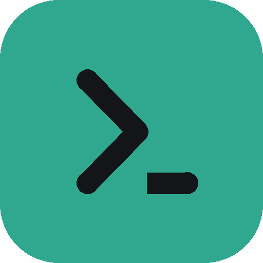
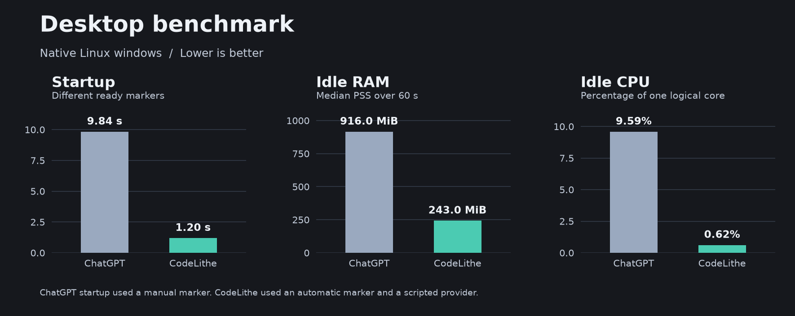
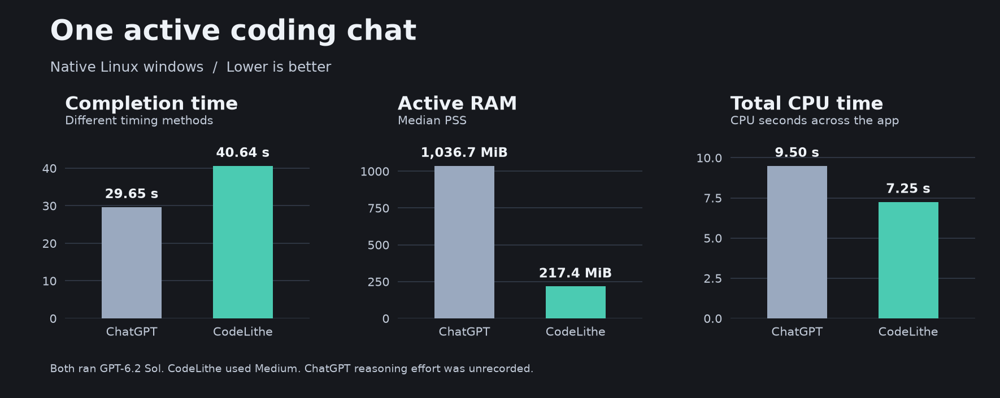
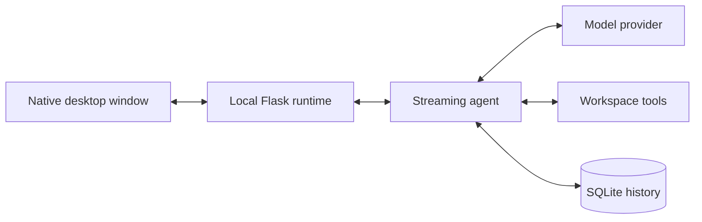

<p align="center">
  
</p>

<h1 align="center">CodeLithe</h1>

<p align="center">
  <strong>A lightweight desktop coding agent for your local projects.</strong><br>
  Open a folder, describe a change, and follow the agent as it reads, edits, and tests your code.
</p>

<p align="center">
  <a href="https://github.com/pythonIsFast/CodeLithe/actions/workflows/release.yml"></a>
  <a href="https://github.com/pythonIsFast/CodeLithe/releases/latest"></a>
  <a href="LICENSE"></a>
</p>

<p align="center">
  <a href="https://github.com/pythonIsFast/CodeLithe/releases/latest"><strong>Download</strong></a> ·
  <a href="#benchmark">Benchmark</a> ·
  <a href="#get-started">Get started</a> ·
  <a href="#features">Features</a> ·
  <a href="#development">Development</a>
</p>

CodeLithe runs the agent and its tools on your machine. It opens in the system's native webview and stores conversations in local SQLite. Sign in with ChatGPT without creating an OpenAI API key. Model requests send the relevant prompts and project context to your chosen provider.

## Benchmark

CodeLithe and ChatGPT Desktop in local Codex mode were measured on the same Zorin OS 18.1 machine. Lower time and resource use are better.



| Measurement | ChatGPT Desktop | CodeLithe |
| --- | ---: | ---: |
| Startup, median | 9.84 s | 1.20 s |
| Idle RAM, median PSS | 916.0 MiB | 243.0 MiB |
| Idle CPU, share of one logical core | 9.59% | 0.62% |
| Coding RAM, median PSS | 1,036.7 MiB | 217.4 MiB |
| Total CPU time during coding | 9.50 s | 7.25 s |
| Coding task completion | 29.65 s | 40.64 s |
| Coding fixture tests | Passed | Passed |

<details>
<summary><strong>See the coding comparison chart</strong></summary>



</details>

ChatGPT used manual timing markers. CodeLithe used automatic markers and a scripted provider for startup and idle. Both coding runs used **GPT‑6.2 Sol with Medium reasoning effort** against a live provider. These are measurements from one machine and one coding run per app.

[Full results, raw data, and reproduction steps](benchmarks/desktop/README.md)

## Get started

### 1. Download and open CodeLithe

Get the file for your system from the [latest release](https://github.com/pythonIsFast/CodeLithe/releases/latest).

| System | Download | How to run |
| --- | --- | --- |
| Windows x64 | `CodeLite-<version>-windows-setup.exe` | Run the per-user installer, then open CodeLithe from Start. |
| Windows x64, portable | `CodeLite-<version>-windows-portable.exe` | Open the downloaded executable. |
| Debian or Ubuntu | `code-lite_<version>_all.deb` | Run `sudo apt install ./code-lite_<version>_all.deb`, then open CodeLithe from the app menu. |
| Linux, zipapp | `code-lite-<version>.pyz` | Run `python3 code-lite-<version>.pyz` with Python and WebKitGTK installed. |

Replace `<version>` with the version in the downloaded filename. The files and Linux launcher keep their legacy names for in-place upgrades. Releases include `SHA256SUMS.txt` for verification.

### 2. Start a session

1. Select **Sign in with ChatGPT** and complete the sign-in in your browser.
2. Choose **New session** and select a project folder.
3. Start with a verifiable task such as “Find the failing tests, fix the smallest relevant issue, and run those tests again.”

New sessions default to **Ask**. You can inspect proposed edits and commands before approving them.

### Run from source

<details>
<summary><strong>Linux and Windows setup</strong></summary>

```sh
git clone https://github.com/pythonIsFast/CodeLithe.git
cd CodeLithe
```

On Debian or Ubuntu, install the system webview and create a virtual environment that can use PyGObject.

```sh
sudo apt install python3-venv python3-gi python3-gi-cairo gir1.2-gtk-3.0 gir1.2-webkit2-4.1
python3 -m venv --system-site-packages .venv
. .venv/bin/activate
python -m pip install -r requirements.txt
python run.py
```

On Windows, install Python and the WebView2 Runtime, then run these commands in PowerShell.

```powershell
py -3 -m venv .venv
.\.venv\Scripts\python.exe -m pip install -r requirements.txt
.\.venv\Scripts\python.exe run.py
```

</details>

## Features

- **Edit and test locally.** Search a workspace, make focused edits, run tests, and inspect tool output as it streams.
- **Manage long conversations.** See context usage and compact older working context while keeping the original transcript available.
- **Choose the model.** Select a model and supported reasoning effort, or use Auto routing. The model picker settings let you hide models you rarely use.
- **Connect OpenCode Go from source.** The current `main` branch supports OpenCode Go alongside ChatGPT. Add the inference key under **Settings → Models & accounts → OpenCode Go**. A separate service account key with **Usage: Read** lets CodeLithe retrieve your Go allowance.
- **Add custom providers from source.** Use **Settings → Models & accounts → Custom providers** to add multiple OpenAI-compatible endpoints. Give each provider a name, an API base URL such as `https://provider.example/v1`, and an API key if required. Paste the full `/responses` URL for the Responses API. Leave model IDs blank for discovery or enter one ID per line. The models then appear alongside ChatGPT and OpenCode Go.
- **Use code intelligence and extensions.** Connect language servers, MCP servers, project skills, and local Python tools. Search the web or open JavaScript-rendered pages in a separate system webview.
- **Bring existing work along.** Import readable Codex CLI history from **Settings → Application → Import conversations**. Optional **Remote Control** opens the UI through a password-protected tunnel while the agent keeps running on your computer.

### Permissions

| Mode | File edits | Shell commands |
| --- | --- | --- |
| **Ask** | Approval required | Approval required |
| **Permit writes** | Allowed | Approval required |
| **Auto** | Allowed | A separate model reviews commands and blocks those it declines |
| **Bypass permissions** | Allowed | Allowed |

An approval can apply once or to a scoped grant for the session. Shell commands run with your user privileges. These permission checks do not provide an operating-system sandbox.

### Computer Use

On Linux X11, choose an image-capable model and turn on **Computer Use** in the chat composer. CodeLithe can see the desktop through screenshots, move the system pointer, click, drag, scroll, and type using your keyboard layout. Screenshots go to the selected model for the next turn.

The floating chat in the lower-right corner shows the current action and accepts follow-up messages. **Turn off** revokes desktop control and stops the current run. Enable the mode from the local CodeLithe window.

### Project configuration

| File or folder | Purpose |
| --- | --- |
| `AGENTS.md` or `CLAUDE.md` | Repository instructions |
| `.codelite/memory.md` | Project memory |
| `.codelite/skills/` | On-demand skills |
| `.codelite/mcp.json` and `.codelite/lsp.json` | MCP and language server configuration |
| `.codelite/tools/` and `.codelite/plugins/` | Local Python tools and hooks |

## Development

The desktop layer uses Flask, pywebview, and plain JavaScript. The provider layer uses Python's standard library.



```sh
python -m pip install pytest
python -m pytest tests -q
```

Use `python run.py --help` for launch options and `python -m codelite.provider --help` for the standalone proxy. See [AGENTS.md](AGENTS.md) for architecture, packaging, and verification instructions. Report bugs and request features in [GitHub Issues](https://github.com/pythonIsFast/CodeLithe/issues).

## License

[Apache License 2.0](LICENSE). See [NOTICE](NOTICE) for attribution.
