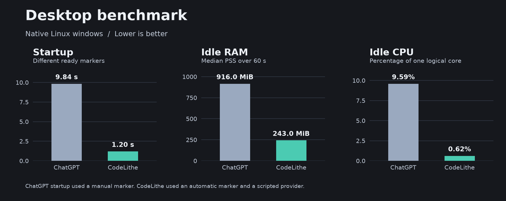
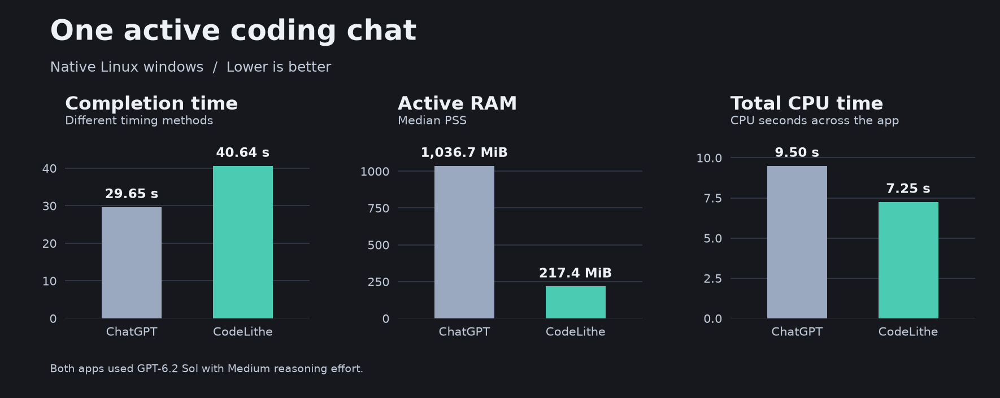

# Desktop benchmark

Compare CodeLithe and the ChatGPT desktop app (using Codex with local workspaces) on the same Linux machine. The benchmark covers app startup, idle resource use, and one active conversation. Each coding task uses a fresh copy of a small Python repository.

## Results



Measured on the same Zorin OS 18.1 machine. Lower values indicate less time or resource use.

| Metric | ChatGPT Desktop 26.1111.21308 | CodeLithe `ea8c53c` |
| --- | ---: | ---: |
| Startup time, median | 9.84 s (2 launches) | 1.20 s (3 launches) |
| Idle RAM, median PSS | 916.0 MiB | 243.0 MiB |
| Idle RAM, observed peak PSS | 1,170.3 MiB | 244.5 MiB |
| Idle CPU, share of one logical core | 9.59% | 0.62% |
| Idle disk read, observed lower bound | 0 B | 0 B |
| Idle disk write, observed lower bound | 1,933,312 B | 4,096 B |

ChatGPT startup includes the time to switch windows and press Enter. CodeLithe startup uses an automatic UI-ready marker. CodeLithe loaded its composer against a scripted provider for startup and idle. Each idle figure comes from one 60-second sample window.

Raw measurements are available for [ChatGPT](results/chatgpt-26.1111.21308.json) and [CodeLithe](results/codelithe-ea8c53c.json). Regenerate the figures with `python3 benchmarks/desktop/render_comparison.py` in an environment with Matplotlib.

### One active coding chat



| Metric | ChatGPT Desktop | CodeLithe |
| --- | ---: | ---: |
| Completion time | 29.65 s | 40.64 s |
| RAM, median PSS | 1,036.7 MiB | 217.4 MiB |
| RAM, observed peak PSS | 1,056.7 MiB | 222.3 MiB |
| Total CPU time | 9.50 s | 7.25 s |
| Average CPU, share of one logical core | 32.04% | 17.85% |
| Disk read, observed lower bound | 0 B | 0 B |
| Disk write, observed lower bound | 163,840 B | 22,511,616 B |
| Fixture tests | Passed | Passed |

Both apps ran the same coding task with GPT-6.2 Sol and Medium reasoning effort against a live provider. ChatGPT used manual terminal markers. CodeLithe used automatic task boundaries. See the [CodeLithe coding run](results/codelithe-ea8c53c-gpt-6.2-sol-medium.json) for the raw measurements.

## Prerequisites

- A graphical Linux session with cgroup v2, a running systemd user manager, Python 3 and Git.
- The ChatGPT Linux desktop app installed with its `chatgpt` launcher on `PATH`.
- CodeLithe's dependencies available to the Python interpreter used for this benchmark. CodeLithe runs from the current checkout.

## Run

From the repository root, open CodeLithe with its separate benchmark profile and sign in. Quit it after signing in. Before measuring ChatGPT, quit all running ChatGPT windows through its app menu so the benchmark can launch its own process.

```sh
python3 benchmarks/desktop/benchmark.py setup
```

Run each app in turn and follow the terminal prompts. For ChatGPT, select **Codex** and use the printed folder as a local workspace. Enter `s` at the coding-task prompt to keep just the startup and idle measurements.

```sh
python3 benchmarks/desktop/benchmark.py run chatgpt
python3 benchmarks/desktop/benchmark.py run codelithe
python3 benchmarks/desktop/benchmark.py report
```

Use the same window size, model, reasoning effort, and comparable approval settings for both apps where possible. Select model and effort in the app. The optional `--model` and `--effort` arguments record those selections in the report. Use `--warmup` to label the first run for each app and alternate apps across repeated runs. For a quick trial, add `--idle-seconds 10`. Regular runs default to 60 seconds of idle sampling.

The report command prints the path to `combined.json`, which contains the measurements and test outcomes. The temporary results, app logs, test repositories, and separate CodeLithe sign-in profile live outside this checkout under `codelithe-desktop-benchmark-<uid>` in the system temporary directory. Share the results file only.

## Measurements

| Metric | How it is measured |
| --- | --- |
| Startup and completion time | Manual terminal markers include reaction time and window switches. |
| CPU | Total CPU time for the app's systemd scope. Percentages are normalized to one logical core. |
| RAM | Median and observed peak PSS across readable processes in the scope. The report flags samples with missing PSS data. |
| Disk | Block read and write bytes from cgroup counters. Where those counters are unavailable, sampled per-process values provide a lower bound and can miss short-lived processes. |
| Task result | The runner checks that the original tests are intact and pass after each coding task. |

Run `python3 benchmarks/desktop/benchmark.py self-test` to check the resource counters and fixture without opening either desktop app.
